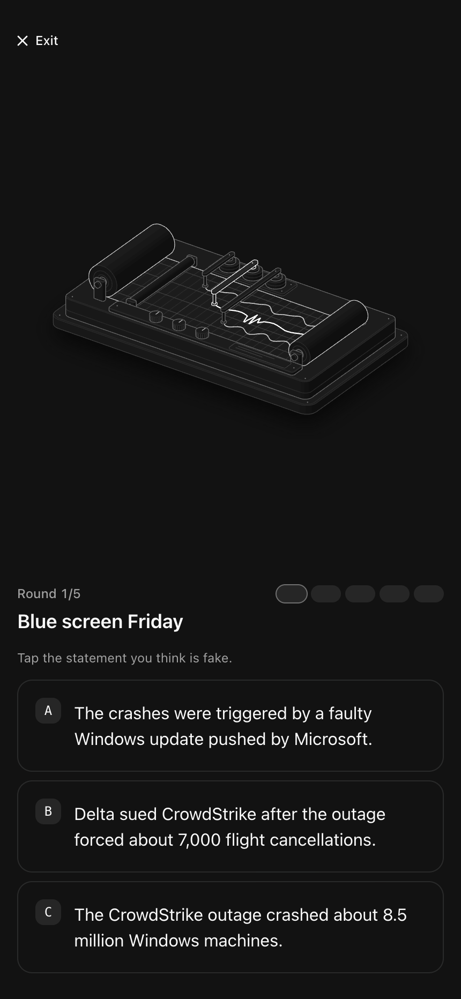
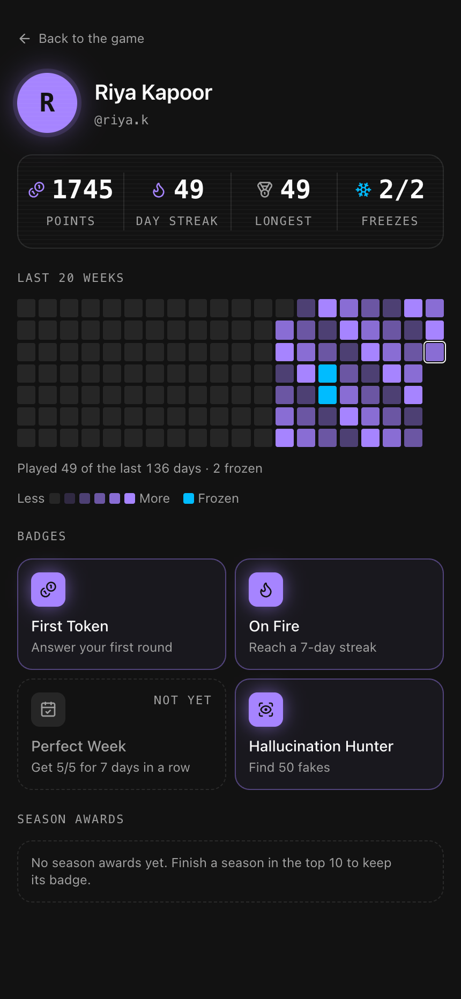
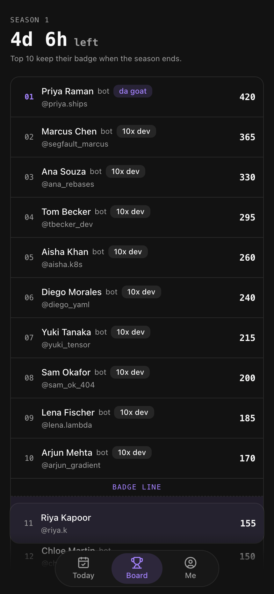
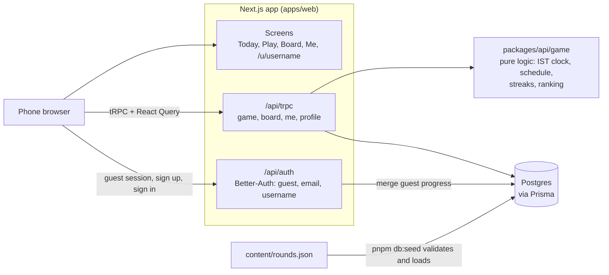

# Hallucinated

A daily "two truths and a hallucination" game about tech, coding and AI, for developers.

Every day everyone gets the same 5 rounds. Each round has three statements about languages, dev tools, tech news, LLMs or AI coding agents. Two are true and one is made up. Pick the fake, see the truth with its source, earn points and keep your streak.

**Live:** [hallucinated.vercel.app](https://hallucinated.vercel.app)

| Round                                         | Profile                                         | Board                                         |
| --------------------------------------------- | ----------------------------------------------- | --------------------------------------------- |
|  |  |  |

## What brings you back

- **One set a day.** 5 rounds, the same for everyone, new at midnight IST.
- **Streaks with freezes.** Finish all 5 rounds to extend your streak. Every 7 days earns a freeze (up to 2), which covers a missed day automatically.
- **Points with a receipt.** +10 per correct round, +20 for a perfect day and a streak bonus. Every point is a ledger entry you can see on Me.
- **Weekly seasons.** The board resets every Monday. #1 holds **da goat**, #2 to #10 hold **10x dev**, and the final top 10 keep their badge on their profile for good.
- **Badges** for your first answer, a 7-day streak, a perfect week and catching 50 fakes.
- **An activity graph** of the last 20 weeks, like GitHub's.

You play as a guest from the first tap. Signing up later keeps everything you earned.

The full rules are in [docs/PROJECT_SPEC.md](docs/PROJECT_SPEC.md).

## How it is built

One Next.js app serves the pages, the tRPC API and auth, on Postgres through Prisma.



A few choices that shape the rest:

- **The server owns the clock and the points.** The client sends only `{ roundId, statementId }`. It never sees which statement is fake until it has answered, and every point is written by the server in one transaction. Retries and double taps cannot score twice.
- **Streaks are computed, not stored.** Streaks, freezes, the graph and badges are worked out from a player's answers on every read, so they can never drift.
- **No cron job.** A finished season is finalized by the first request that reads the board or a profile after it ends.
- **Date and ranking logic is pure functions** in `packages/api/src/game`, unit tested without a database.

The details, including the data model and the answer transaction, are in [docs/ARCHITECTURE.md](docs/ARCHITECTURE.md).

## Run it locally

You need Node 20.9+, [pnpm](https://pnpm.io) 11, [Bun](https://bun.sh) (runs the seed scripts), the [Neon CLI](https://neon.com/docs/cli) (`npm i -g neon`) and Docker for the E2E suite.

```bash
git clone https://github.com/koushikxd/kenpathlabs.git
cd kenpathlabs
pnpm install
```

Create `apps/web/.env`, then create a free Neon project and pull its connection strings into `apps/web/.env.local`:

```bash
cat > apps/web/.env <<EOF
BETTER_AUTH_SECRET=$(openssl rand -hex 32)
BETTER_AUTH_URL=http://localhost:3000
EOF
neon auth
neon link --project-name hallucinated --region-id aws-us-east-2
neon env pull --file apps/web/.env.local   # DATABASE_URL (pooled), DATABASE_URL_UNPOOLED (direct)
```

Any Postgres works too: set `DATABASE_URL` and `DATABASE_URL_UNPOOLED` to the same URL by hand.

Set up the database and run the app:

```bash
pnpm db:generate        # Prisma client
pnpm db:migrate         # create the tables
pnpm db:seed            # validate and load the 70 rounds
pnpm db:seed:demo       # 20 bot players with a played history, so the board is not empty
pnpm dev
```

Open [http://localhost:3000](http://localhost:3000). Use your browser's device toolbar for the phone layout.

Bots play up to yesterday. Run `pnpm db:seed:demo` again later to carry their history on to the new yesterday.

## Tests

```bash
pnpm test        # unit tests: clock, schedule, streaks, ranking, content validator
pnpm test:e2e    # Playwright on an emulated Pixel 5 over slow 4G
```

The E2E suite needs only Docker running (`pnpm db:start`, Postgres 17 on port 5432) and Bun. It never touches Neon. It creates its own database and starts its own server on port 3100, so it can run while `pnpm dev` is up. It fakes the server clock to cross midnight and the end of a season. Every test leaves a trace and a final screenshot in `apps/web/test-results/`.

## Scripts

| Command            | What it does                                |
| ------------------ | ------------------------------------------- |
| `pnpm dev`         | Start the app on port 3000                  |
| `pnpm check-types` | Type-check every package                    |
| `pnpm check`       | Oxlint and Oxfmt (also run on every commit) |
| `pnpm db:studio`   | Browse the database                         |
| `pnpm db:stop`     | Stop the E2E Postgres container             |

## Repository

```
apps/web/          Next.js app: screens, API routes, E2E tests
packages/api/      tRPC routers and the pure game logic
packages/auth/     Better-Auth config and the guest progress merge
packages/db/       Prisma schema, migrations, seed scripts
packages/ui/       shared shadcn components and design tokens
content/           the round content
tools/anatomy/     scripts that draw the round illustrations
docs/              spec, architecture, screenshots
```

## Docs

- [docs/PROJECT_SPEC.md](docs/PROJECT_SPEC.md): the product. Rules for days, points, streaks, badges, seasons and accounts, every screen, and what is out of scope.
- [docs/ARCHITECTURE.md](docs/ARCHITECTURE.md): the stack, data model, answer transaction, season finalization, guest accounts, testing and known gaps.
- [DESIGN.md](DESIGN.md): design tokens and component rules.

## What I left out

The content is a curated set of 70 sourced rounds rather than live news, and it loops after 14 days. The answer key in `content/rounds.json` is public along with the rest of the repo. More in the [spec](docs/PROJECT_SPEC.md#out-of-scope).

## Where I used AI

I used Claude Code and Codex for most of the implementation. I wrote the spec and architecture first, split the work into GitHub issues, and ran one agent session per issue in order, with [AGENTS.md](AGENTS.md) as its instructions. Each session left a handoff note, which I have since folded into the docs. Claude also helped write this README and the docs.
